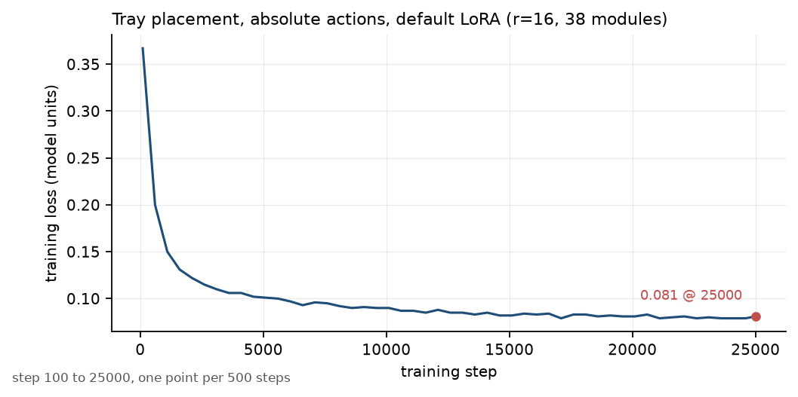
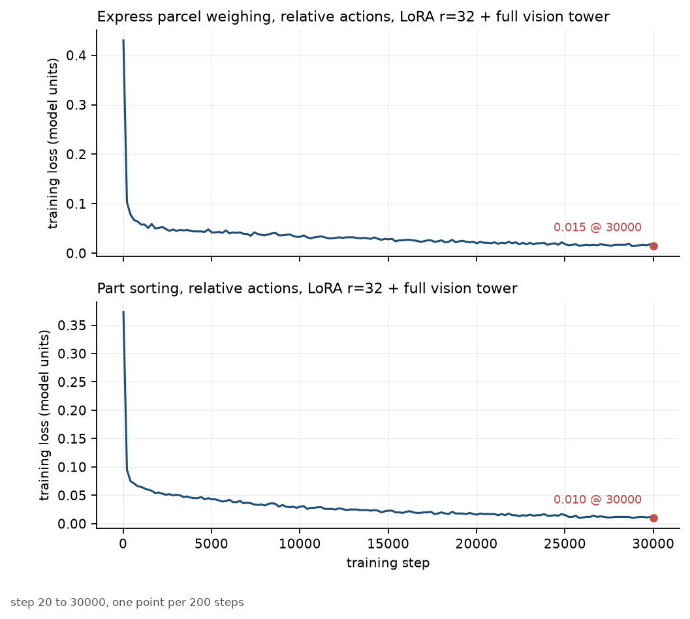
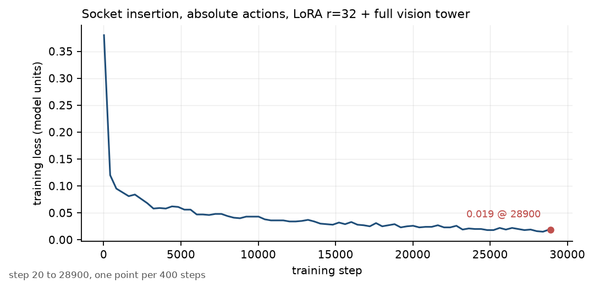

# Kuavo 5 × π0.5: VLA fine-tuning and deployment for a humanoid manipulator

Engineering notes on adapting a vision-language-action model (π0.5) to a dual-arm humanoid,
diagnosing why the deployed policy moved incoherently, and measuring the rank requirements of the
weight update. The repository contains the write-ups, the reproducible analyses, and downsampled
loss curves. It does not contain the dataset, the weights, or the training code.

Context: Challenge Cup "bounty" track XH-202611, *Humanoid robot embodied manipulation technology*,
sponsored by Leju Robotics. Four industrial manipulation tasks on the Kuavo 5 platform. Role: model
training and deployment lead.



## Context

- **Robot and data.** Dual-arm Kuavo 5, 16-D joint state/action (7 + 1 gripper per arm), three
  848×480 cameras at 10 Hz. The datasets are per-task, 500 demonstrations each, already in LeRobot
  format. **We did not collect the data and did not convert it** - both were provided by the
  sponsor. Data-side work was limited to action representation, recomputing relative-action
  statistics in an isolated data root, and leaving the shared root untouched.
- **Tasks.** Express parcel weighing and placement, part sorting, tray placement, plug connection.
- **Model.** π0.5: PaliGemma-based vision-language backbone plus a Gemma action expert, 4.14 B
  parameters in the default-LoRA configuration, chunked action head.
- **Stack.** LeRobot (π0.5 policy, data pipeline), PEFT/LoRA, PyTorch, bf16, gradient checkpointing;
  4×A100-40G, 4×RTX 5880 and 4×RTX4090-24G nodes; deployment through the vendor's robot-control
  package.

## System composition

| layer | component | work done here |
|---|---|---|
| data | per-task LeRobot datasets provided by the sponsor (500 demonstrations, 10 Hz, 16-D, 3 cameras) | no collection, no format conversion; action-representation setup and relative-statistics recomputation in isolated data roots |
| training | LeRobot π0.5 policy (PaliGemma VLM + Gemma action expert), PEFT/LoRA, bf16, gradient checkpointing | configuration audit, LoRA coverage and vision unfreeze, rank measurement, representation/normalization ablations |
| checkpoint | full checkpoint plus PEFT adapter plus pre/post-processor JSON | load-path checks, trainable-parameter accounting, reduced-rank variant |
| deployment | vendor dual-arm robot-control package, action-chunk policy server | root cause and fix of the loader that lost non-persistent positional buffers |
| evaluation | offline action error, physical robot runs | protocol described; numbers not published here (see `PROVENANCE.md`, section 4) |

## Key findings

1. **The framework-default LoRA recipe trains far less than it appears to.** Due to a stale target
   regex inherited from π0, the default adapters hit 38 modules and 1,287,168 parameters (0.031% of
   the model): the action expert's `q/v` projections and two action projections. The 2 B language
   trunk gets **zero** adapters and the vision tower stays frozen. Loss still goes down, so nothing
   in the curve reveals it. An explicit target list covers 256 modules; a later revision adds the
   multimodal projector, giving 257. See
   [docs/01](docs/01_pi05_integration_contract.md).
2. **Measured rank requirements: LoRA is enough for the language/action side, not for vision.** For
   a trained checkpoint, 99% of the update energy needs a median of 8-11 directions in the language
   model (worst layer 25) and 5-6 in the action expert, but **704 of 1152** in the vision tower. The
   vision update is close to full rank, so it must be full-parameter; a LoRA adapter would need
   `r ≈ 600-1000`. The multimodal projector is the only module pinned at the rank cap
   (`k@0.99 = 30` with `r = 32`), which motivated a follow-up that was never run. See
   [docs/02](docs/02_lora_parameter_budget_and_rank_spectrum.md).
3. **Training loss cannot choose an action representation.** An absolute-vs-relative pair held every
   other variable fixed (same data, LoRA, batch, seed, 25k steps): 0.081 vs 0.054 terminal training
   loss, but the two losses are on different scales because the target changed. The pair is a
   protocol for downstream evaluation, not a ranking. See
   [docs/04](docs/04_representation_and_normalization_ablations.md).
4. **A normalization change was rejected by measurement.** `MEAN_STD` scaling was 2.0× the default
   `QUANTILES` loss at every matched step from 100 to 10,000; `QUANTILE10` was 1.80× early but its
   run was terminated after 863 steps and is only a direction. The default was kept.
5. **The deployed policy's incoherent motion was a loader bug, not a model bug.** Constructing the
   policy on `meta` and allocating with `to_empty` leaves non-persistent buffers uninitialized, and
   the checkpoint does not contain them: Gemma RoPE frequencies become `[1.4e-45, ...]` and SigLIP
   position indices become large garbage integers. Rebuilding these buffers from config after
   allocation fixed it. The internal offline replay reports a six-frame action MAE of
   0.268 → 0.0145 rad; the robot was not connected for that check. See
   [docs/03](docs/03_deploy_nonpersistent_buffers.md).

## Numbers and where they come from

All numbers below are traced in [`PROVENANCE.md`](PROVENANCE.md). Evidence tags: ✅ measured,
🟡 strong inference, ❓ unverified. Loss values are training objective values in model units.

| quantity | value | evidence |
|---|---:|---|
| default LoRA: modules / trainable params | 38 / 1,287,168 (0.031%) | ✅ launch log; cross-checked against an older r=32 run (2,574,336 = 2×) |
| explicit LoRA: modules | 256 in the first explicit revision; 257 after adding the multimodal projector (126 LM + 126 expert + 5 projection-ish) | ✅ launch log / parameter check |
| final recipe (256 modules): trainable params | 53,282,816 LoRA + 412,442,352 vision = 465,725,168 (10.1%) | ✅ launch log |
| reduced-rank recipe: trainable params | 23,377,920 LoRA + 412,442,352 vision = 435,820,272 | ✅ observed identically on two machines |
| tray, absolute, default LoRA, 25k steps | loss 0.367 @100 → **0.081** @25k | ✅ `data/tray_absolute_default_lora.csv` |
| tray, relative-except-claw, default LoRA, 25k steps | loss **0.054** @25k | ✅ run log quote (not exported as csv) |
| express parcel, relative, 30k steps | loss 0.430 → **0.015** (min 0.013) | ✅ `data/kuaidi_rel_30k.csv` |
| part sorting, relative, 30k steps | loss 0.373 → **0.010** (min 0.009) | ✅ `data/cixilingjian_rel_30k.csv` |
| socket insertion, absolute, 28.9k logged steps | loss 0.380 → **0.019** | ✅ `data/socket_absolute_b12.csv` |
| rank requirement, vision tower | k@0.99 median 704 / max 1026 (full rank 1152) | ✅ two checkpoints, identical verdict |
| rank requirement, language model | k@0.99 median 8-11 / max 25 | ✅ same |
| rank requirement, action expert | k@0.99 median 5-6 / max 15-17 | ✅ same |
| rank requirement, multimodal projector | k@0.99 = 30 / 30 at `r = 32` | ✅ same; follow-up not run ❓ |
| deploy: RoPE `inv_freq` after `meta → to_empty` | `[1.4013e-45, 1.4013e-45, 0, 1.3873e-43, 0, 0]` vs reference `[1.0000, 0.9306, ...]` | ✅ isolated module check |
| deploy: six-frame action MAE, before → after | 0.267916 → 0.014516 rad | 🟡 internal offline replay; raw logs not in this repo |
| normalization A/B (MEAN_STD vs default) | 2.0× loss at every matched step, 100-10,000 | ✅ internal note; default column reproducible from `data/` |

The repository does **not** quote task success rates or held-out action errors. Those measurements
exist in team records but their raw logs are not part of this export, so they are listed in
`PROVENANCE.md` under *not included* instead of being used as claims.

## Repository map

| path | content |
|---|---|
| [`docs/01_pi05_integration_contract.md`](docs/01_pi05_integration_contract.md) | what the framework actually does with 16-D actions, state-as-text, camera keys; silent failure modes; parameter accounting |
| [`docs/02_lora_parameter_budget_and_rank_spectrum.md`](docs/02_lora_parameter_budget_and_rank_spectrum.md) | measured cumulative spectral energy and effective rank per module group; the projector hypothesis; the reduced-rank design |
| [`docs/03_deploy_nonpersistent_buffers.md`](docs/03_deploy_nonpersistent_buffers.md) | root cause and fix of incoherent deployed actions; buffer evidence; remaining fork-vs-reference differences |
| [`docs/04_representation_and_normalization_ablations.md`](docs/04_representation_and_normalization_ablations.md) | run inventory; absolute vs relative; normalization comparison; metric hierarchy |
| [`data/`](data/README.md) | downsampled loss histories and the downsampling rule |
| [`figures/`](figures/) | loss-curve figures generated from `data/` |
| [`scripts/plot_loss.py`](scripts/plot_loss.py) | regenerates the figures |
| [`scripts/rank_spectrum.py`](scripts/rank_spectrum.py) | cumulative spectral energy, `k@0.99`, Eckart-Young bound, LoRA update, numpy safetensors reader, `--selftest` |
| [`PROVENANCE.md`](PROVENANCE.md) | every number → source file, section, line, or derivation |
| [`NOTICE.md`](NOTICE.md) | what is not public and why |

## Figures

| figure | run |
|---|---|
|  | tray placement, absolute actions, framework-default LoRA r=16 (38 modules, vision frozen), 4×A100-40G, 25k steps. Terminal loss 0.081. |
|  | express parcel weighing (top) and part sorting (bottom), relative actions, LoRA r=32 + full vision tower, 4×RTX 5880, 30k steps. The two panels are separate tasks and the losses are not comparable. |
|  | socket insertion, absolute actions, LoRA r=32 + full vision tower, 4×RTX4090-24G, batch 12. Logged through 28.9k steps. |

## Reproduce

```bash
# figures (writes PNGs into figures/; matplotlib only)
python scripts/plot_loss.py

# spectral-energy analysis: synthetic recovery check (numpy only, exits non-zero on failure)
python scripts/rank_spectrum.py --selftest

# and, given weights that are not public:
python scripts/rank_spectrum.py --adapter adapter_model.safetensors \
    --base model.safetensors --lora-alpha 8 --lora-r 32
```

`rank_spectrum.py --selftest` builds a rank-8 synthetic update with known singular values and
verifies the recovered singular values, `k@0.99`, the Eckart-Young error identity
`sqrt(1-E(k))`, LoRA scaling, scale invariance, zero-matrix handling, and the safetensors reader
(fp32 and bf16).

## Why the code and data are not public

The demonstrations and the base weights belong to the competition sponsor and are not ours to
redistribute. The training and deployment code is shared team work built on LeRobot/PEFT, and the
internal notes contain cluster and robot-host details. What remains publishable is the engineering
record: the mechanisms, the measurements, the negative results, and the analyses that can be
re-derived from the numbers given here. See [`NOTICE.md`](NOTICE.md).

## 中文要点

- **任务背景**：挑战杯揭榜挂帅 XH-202611，乐聚 Kuavo 5 双臂人形，四项工业操作（快递称重放置 /
  零件分拣 / 料盘出库 / 插座连接）。数据由发榜单位提供，我们未做采集与格式转换。本人负责模型训练
  与真机部署。
- **最大的一手发现**：框架默认 LoRA 只训到 38 个模块、129 万参数，语言主干一个适配器都没有、视觉塔
  全程冻结；loss 照样下降，曲线完全看不出来。
- **秩谱实测**：语义上"语言/动作侧用 LoRA 足够、视觉侧必须全参"不是一个设计偏好，而是测出来的：
  语言主干 `k@0.99` 中位 8–11、动作专家 5–6，视觉塔 704/1152。多模态投影层唯一贴着 r=32 上限
  （30/30），后续提秩假设未验证。
- **对照实验的边界**：绝对/相对动作的 loss 不可比（目标定义变了）；`MEAN_STD` 归一化在每一个相同
  step 上都是默认的 2.0 倍，所以回默认；QUANTILE10 只跑了 863 步，只当旁证。
- **部署排障**：真机动作不连贯的根因是 `meta` + `to_empty` 加载时非持久缓冲（RoPE 频率表、SigLIP
  位置索引）未被重建，读到未初始化内存；修复后离线六帧动作 MAE 0.268 → 0.0145 rad（该数值为内部
  离线对照，原始日志未收录，且未连接真机）。
- **仓库边界**：本仓库只放可公开的工程记录与可复现分析，不含数据、权重、训练代码与真机成功率；
  每个数字都能在 `PROVENANCE.md` 追到出处，追不到的已标注"不计入"。
